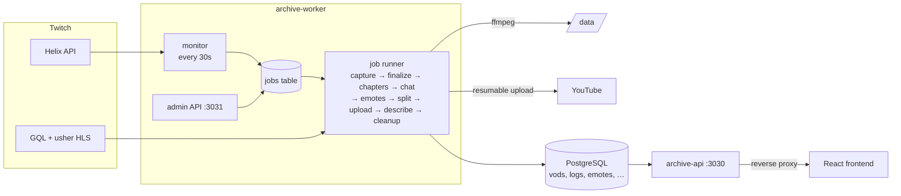

# twitch-archive

A Python rewrite of the Feathers/Node archive backend (fork of
[TimIsOverpowered/archive](https://github.com/TimIsOverpowered/archive)). It is
split into two services that share one database and one codebase:

| Service | What it does | Port |
|---|---|---|
| **archive-api** | Read-only HTTP API for the React frontend (`Archive-React-Vex`). It responds in the same format as the old Feathers API. | 3030 |
| **archive-worker** | Watches Twitch. For every stream it downloads the VOD (and optionally records the live stream), saves chapters, chat and emotes, splits the video, and uploads it to YouTube. It also exposes an admin HTTP API. | 3031 (private network only) |

Scope: Twitch only. Kick, Google Drive and per-game uploads are gone.



**How it differs from the old Node app:**

- **Twitch download is up to date.** It uses the new `PlaybackAccessToken` hash, the usher `/vod/v2/` playlists, and the chunked → 1080p fallback on 403. fMP4 init segments are handled. All GQL hashes and client IDs are settings, so the next Twitch rotation is a config change.
- **Jobs are durable.** Every job is a list of steps, and progress is stored in Postgres (the `jobs` table). A restart or crash resumes a job at the first unfinished step; finished steps never run again. Failed steps are retried with backoff (3 attempts).
- **No Redis.** Caches and the rate limiter live in process memory.
- **No config file writes.** The YouTube OAuth token is kept in the `app_state` table.
- **Fixed bugs:** `/v2/badges` (it crashed on every request), `$select`, `chapters[name]` (regex injection, and it now combines with other filters), duplicate `streams` inserts, reupload offsets, and splitting VODs that have no chapters.
- **Schema changes are additive only** (new `jobs` and `app_state` tables, plus two indexes on `logs`), so the old app still runs against the same database.

---

## Documentation

- [Quick start (local development)](#quick-start-local-development) (below)
- [Configuration](docs/configuration.md)
- [YouTube OAuth setup](docs/youtube-oauth.md)
- [Admin API](docs/admin-api.md)
- [Live recordings and multiTrack](docs/live-recordings.md)
- [Public API reference](docs/public-api.md)
- [Deployment (Docker Compose)](docs/deployment.md)
- [Operations and troubleshooting](docs/operations.md)
- [Development](docs/development.md)
- [Architecture decisions](docs/adr/)

---

## Quick start (local development)

You need Python 3.13, [uv](https://docs.astral.sh/uv/), Docker, and ffmpeg/ffprobe on `PATH` (the worker only).

```bash
uv sync                                        # creates .venv with all three packages
docker compose -f compose.dev.yaml up -d       # Postgres 17 on 127.0.0.1:55433 (postgres/dev)

# optional: load a copy of production data
docker compose -f compose.dev.yaml exec -T db pg_restore -U postgres -d archive --no-owner < archive.dump

uv run alembic upgrade head                    # legacy baseline (no-op on existing tables) + jobs/indexes
uv run archive-api                             # http://127.0.0.1:3030/vods
ARCHIVE_ADMIN_API_KEY=dev uv run archive-worker run --dry-run
```

`--dry-run` downloads and processes everything but never uploads to YouTube and never deletes files. Without Twitch credentials the monitor is disabled, but admin-triggered jobs still work: the GQL and usher endpoints need no credentials.

To point the frontend at your local API, run `Archive-React-Vex` with `REACT_APP_VODS_API_BASE=http://127.0.0.1:3030`.
